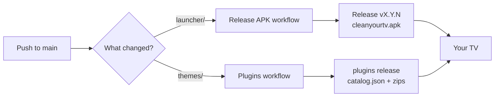

<h1 align="center">CLEANTV</h1>

<p align="center">
  <b>Your Android TV, minus the ads.</b><br>
  Debloat any Android TV or Google TV over Wi-Fi, swap the ad-filled home screen for a clean launcher,<br>
  and change its look with plugins you install from the couch.
</p>

<p align="center">
  <a href="https://github.com/ST-DEVPT/CLEANTV/releases/latest/download/cleanyourtv.apk"></a>
  <a href="https://github.com/ST-DEVPT/CLEANTV/actions/workflows/ci.yml"></a>
  <a href="https://github.com/ST-DEVPT/CLEANTV/releases/tag/plugins"></a>
  <a href="LICENSE"></a>
</p>

<p align="center">
  
</p>

---

## Why

Stock Android TV homes are billboards: sponsored rows, autoplaying trailers, telemetry, and apps you
never asked for. CLEANTV turns them off and gives you a quiet, fast home screen instead.

- **No root, no cable.** Everything runs over the TV's own network debugging (ADB).
- **Nothing uninstalled.** Packages are disabled, and one script restores the TV as it was.
- **Small.** The launcher is about 440 KB and is built for TVs with 1 GB of RAM.
- **No local build.** GitHub Actions builds and signs every release; you just download the APK.
- **Plugins.** Themes are published on GitHub and installed from the TV in two clicks.

> Based on [Gathin23/cleanyourtv](https://github.com/Gathin23/cleanyourtv), with CI-built releases and a
> plugin store added. Upstream's debloat lists and fixes can be merged in at any time.

## What you get

| | |
|---|---|
|  |  |
| **Dock and top shelf.** Your favourite apps in a band, the focused one named in large type over a glow taken from its artwork. | **Inputs, Wi-Fi, Settings.** HDMI ports under the names you gave them, the network name, and the TV's settings one press away. |
|  |  |
| **Plugins.** Wallpapers, colours, dock and layout change without reinstalling anything. | **Clock screensaver.** A thin clock that drifts slowly so nothing burns in. |

## Quick start

**1. Turn on debugging on the TV.** Settings → Device Preferences → About → press OK on **Build** seven
times. Then Developer options → **USB debugging** on (and **Network debugging**, if your TV has it).

**2. Install the launcher** from a computer on the same network:

```bash
adb connect <tv-ip>:5555                       # accept "Allow USB debugging?" on the TV
curl -LO https://github.com/ST-DEVPT/CLEANTV/releases/latest/download/cleanyourtv.apk
adb install -r cleanyourtv.apk
adb shell cmd package set-home-activity com.gathin.tvhome/.MainActivity
adb shell input keyevent KEYCODE_HOME
```

**3. Debloat (optional but recommended).** Paste [`PROMPT.md`](PROMPT.md) into a coding assistant with
shell access (Claude Code, Codex, Gemini CLI) and fill in your TV model. It backs up the TV, finds the
bloat, asks before touching anything you might use, and checks each step with screenshots. Prefer to do
it yourself? Follow [Doing it by hand](GUIDE.md#doing-it-by-hand). Tested lists for 190 TV models are in
[`examples/`](examples/README.md).

> [!TIP]
> Changed your mind? `TV_HOST=<tv-ip> tools/restore.sh examples/<your-tv>/debloat.txt` re-enables
> everything with the same list you debloated with and gives Home back to the stock launcher.

## Using it

| Remote | What it does |
|---|---|
| **Left / Right / Up / Down** | Move between tiles. Down from the dock opens the app grid. |
| **OK** | Open the app. |
| **Hold OK on a tile** | Open the app's info page (force stop, clear data, uninstall). |
| **Hold OK on Settings** | Launcher settings, **Plugins**, edit the dock, reorder tiles. |
| **Back** | Back to the dock. |

## Plugins

A plugin restyles the launcher: wallpaper (or a rotating set), background colour, dock apps, columns,
motion and more. Installing one replaces the current theme; **Remove plugin** goes back to the built-in
look.

**On the TV:** highlight **Settings**, hold **OK**, choose **Plugins**, pick one and press **Install**.
Home reloads with the new look. The download is checked against the catalog's SHA-256 first.

| Plugin | Look |
|---|---|
| **Aurora** | Dark aurora wallpaper, teal and violet on navy |
| **Scenes** | 14 illustrated landscapes, a new one every hour |
| **Dussehra** | Festive marigolds, rangoli, diya and a petal shower |
| **Six columns** | Smaller tiles, six per row |
| **Default** | The built-in look, written out as a starting point |

### Publish your own

No tools needed, just the GitHub website:

1. In this repo open [`themes/`](themes/) → **Add file → Upload files**.
2. Add a folder `themes/<your-id>/` with:
   ```text
   plugin.json     {"name": "Sunset", "version": "1.0.0", "description": "Warm evening sky.", "author": "you"}
   config.json     the look: see themes/README.md for every key
   wallpaper.jpg   optional, 1920x1080 works best (or a wallpapers/ folder to rotate)
   ```
3. Commit to `main`. The **Plugins** workflow checks it, zips it and publishes it. TVs see it the next
   time the store opens.

Bump `version` to ship an update; delete the folder to unpublish. The full format and the checks are in
[docs/plugins.md](docs/plugins.md); every theme key is in [themes/README.md](themes/README.md).

## How releases work



- **APK:** every launcher change becomes a release; the newest is always at
  [`releases/latest/download/cleanyourtv.apk`](https://github.com/ST-DEVPT/CLEANTV/releases/latest/download/cleanyourtv.apk).
- **Signing:** set the four `SIGNING_*` repository secrets once so each release installs over the last
  one. How: [docs/plugins.md](docs/plugins.md#signing-key-do-this-once).
- **CI:** every push and pull request runs the unit tests, lint and an APK size check.

## Supported TVs

| Platform | What works |
|---|---|
| **Android TV, Google TV** | Debloat and launcher |
| **Fire TV** | Debloat only; Fire OS won't hand Home to another launcher |
| **Samsung (Tizen), LG (webOS)** | Not supported: different systems |

The launcher needs Android 8.0 (API 26) or newer. Model-specific notes and fixes are in the
[setup guide](GUIDE.md#supported-tvs) and [Troubleshooting](docs/TROUBLESHOOTING.md).

## Repository

| Path | What's inside |
|---|---|
| [`launcher/`](launcher/) | The home screen app (Java, Gradle) |
| [`themes/`](themes/) | Themes; each one with a `plugin.json` is a plugin |
| [`examples/`](examples/README.md) | Tested debloat lists, one folder per TV model |
| [`tools/`](tools/) | Debloat, restore, theme and plugin-catalog scripts |
| [`docs/`](docs/) | Plugins, troubleshooting, remote setup, module cards, per-device notes |
| [`GUIDE.md`](GUIDE.md) | The full setup guide: by hand, restoring, firmware updates, FAQ |
| [`PROMPT.md`](PROMPT.md) | The prompt for your coding assistant |

<details>
<summary><b>Build locally (optional)</b></summary>

You don't need to: GitHub builds every release. If you want to anyway, with JDK 17 and the Android SDK
(platform 34):

```bash
cd launcher
./gradlew testReleaseUnitTest assembleRelease \
  -PpluginCatalogUrl=https://github.com/ST-DEVPT/CLEANTV/releases/download/plugins/catalog.json
adb install -r app/build/outputs/apk/release/app-release.apk
```

Without `-PpluginCatalogUrl` the Plugins screen says the build has no catalog.
</details>

<details>
<summary><b>Pull updates from upstream</b></summary>

```bash
git remote add upstream https://github.com/Gathin23/cleanyourtv   # once
git fetch upstream
git merge upstream/main
```
</details>

## Contributing

TV debloat lists, plugins and launcher fixes are all welcome. Start with
[CONTRIBUTING.md](CONTRIBUTING.md); for a plugin, a pull request that adds a `themes/<id>/` folder is
enough, and CI checks it for you.

## Licence

MIT, see [LICENSE](LICENSE). Launcher and debloat lists by [Gathin](https://github.com/Gathin23) and the
CleanYourTV contributors. The Outfit typeface is under the SIL Open Font License
([launcher/FONT-LICENSE-OFL.txt](launcher/FONT-LICENSE-OFL.txt)).
